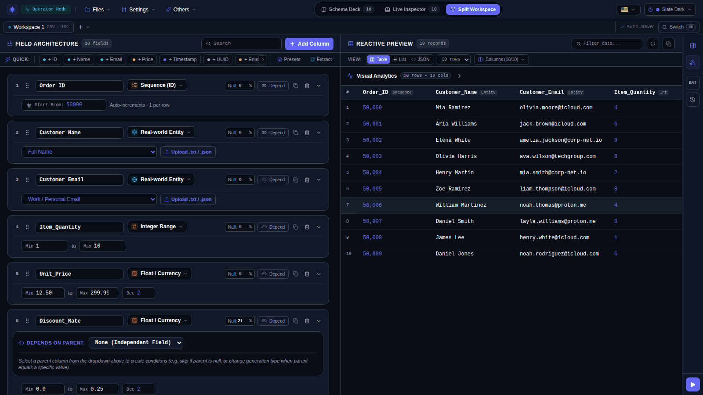
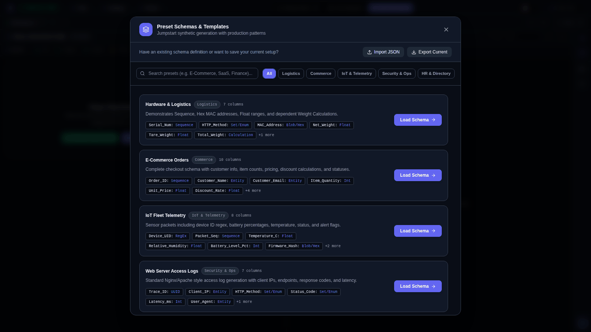
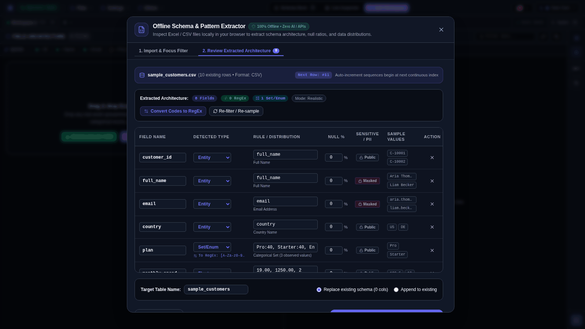
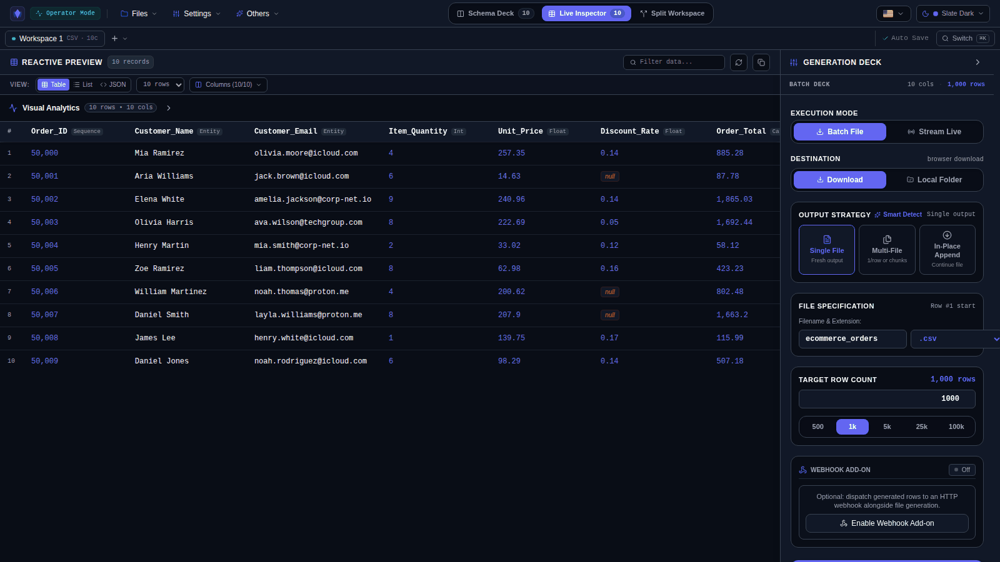
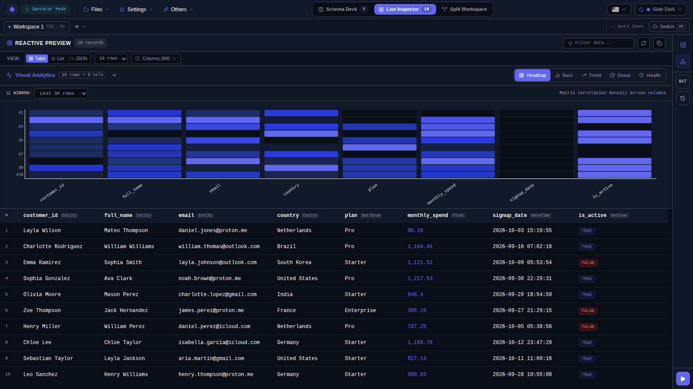
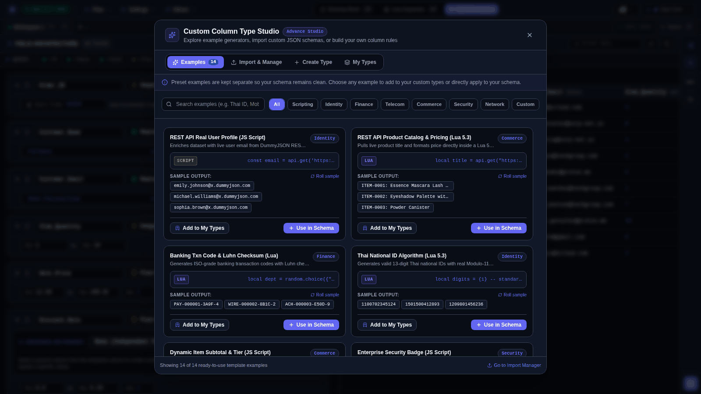
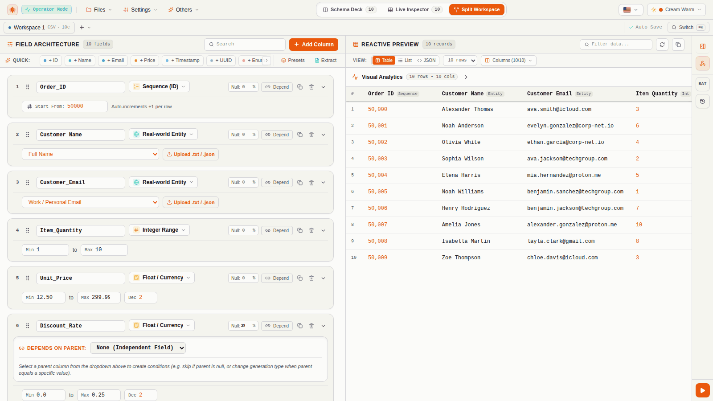
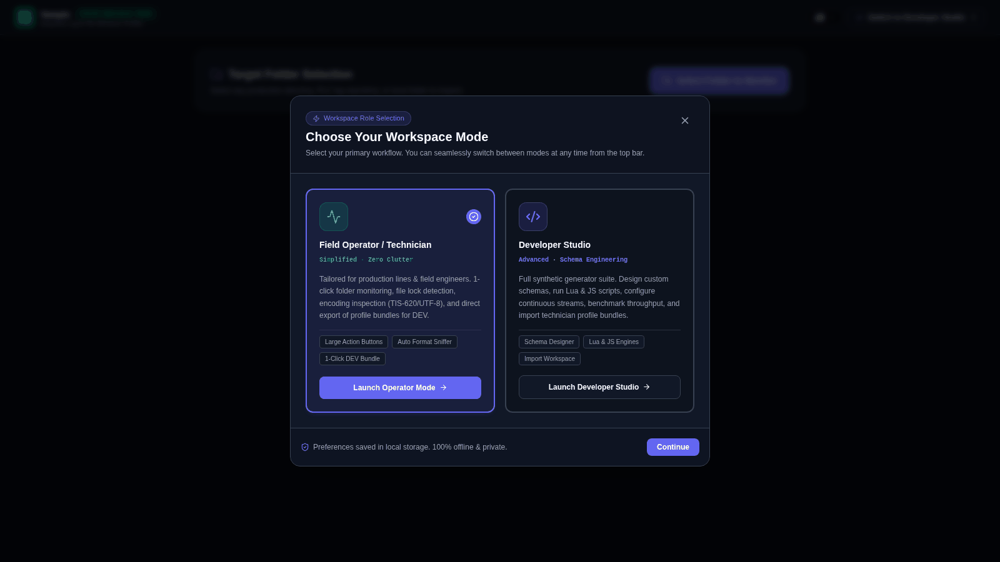

# VAMPIO

**Offline-first synthetic data generator and schema extractor.**
Design a schema (or reverse-engineer one from an Excel/CSV file), watch live sample data update as you edit, then generate large datasets straight to disk. Everything runs on your machine, either in the browser or as a native desktop app, with no cloud services or external APIs involved.

[](https://github.com/Sepiolina/Vampio/actions/workflows/CI.yml)
[](https://github.com/Sepiolina/Vampio/actions/workflows/release.yml)



---

## Features

| | |
| :--- | :--- |
| **Schema designer** | 12 column types (Sequence, Entity, Int, Float, DateTime, UUID, Boolean, Set/Enum, RegEx, String, Blob/Hex, Calculation), drag-to-reorder, per-column null %, uniqueness, and cross-column dependencies. |
| **Live preview** | Table, List, and JSON views regenerate instantly as you edit, with tokenized search and right-click cell filters. |
| **Offline schema extractor** | Drop an `.xlsx`, `.xls`, or `.csv` file and Vampio infers types, enums, regex patterns, and null ratios, and flags likely sensitive (PII) columns, all in memory. |
| **Visual analytics** | Five D3 views (Heatmap, Bars, Trend, Donut, Health) to check that generated data has the distribution you intended. |
| **High-volume output** | Batch or live-stream generation to CSV, TSV, JSON, JSONL, SQL, XML, TXT, or XLSX/XLS. Single file, multi-file, or in-place append, written to disk with chunked streaming. |
| **Custom types and scripting** | Build reusable column types with Lua or JavaScript, optionally enriched from REST APIs. A Custom Column Type Studio ships with ready-made examples. |
| **Webhook actions** | Optionally push generated rows to a REST/JSON, custom webhook, or GraphQL endpoint with batching, retries, throttling, and trigger conditions. |
| **Operator mode** | A simplified mode for field technicians: point it at a folder, get an encoding, delimiter, and file-lock profile, and export a profile bundle that a developer can import. |
| **Workspaces** | Multiple tabs, configurable save policy, a quick switcher (`Ctrl/Cmd+K`), and importable workspace bundles. |
| **Themes and languages** | 10 themes (6 light, 4 dark). UI in English, Spanish, Chinese, Japanese, and Thai. |

## Screenshots

| Presets | Offline schema extractor |
| :---: | :---: |
|  |  |
| **Generation deck** | **Visual analytics** |
|  |  |
| **Custom Column Type Studio** | **Light theme** |
|  |  |

See the [**interface tour**](./docs/user-interface.md) for a full walkthrough.

---

## Quick start

**Requirements:** Node.js 20 or newer. The Rust toolchain is only needed for the desktop build.

```bash
git clone https://github.com/Sepiolina/Vampio.git
cd Vampio
npm install

npm run dev          # web app at http://localhost:3000
npm run tauri:dev    # native desktop window (needs Rust + Tauri prerequisites)
```

On first launch Vampio asks which workspace mode you want. Pick **Developer Studio** to design schemas and generate data, or **Operator Mode** for folder monitoring. You can switch at any time from the top bar.



### Your first dataset in 60 seconds

1. Click **Presets** and load **E-Commerce Orders** (or click **Browse Excel / CSV** to extract a schema from your own file).
2. Tweak a column in the left panel. The preview on the right updates immediately.
3. Open the **Generation Deck**, choose a format and row count, and press **Generate**.

---

## Scripts

| Command | What it does |
| :--- | :--- |
| `npm run dev` | Vite dev server on port 3000. |
| `npm run build` | Production web build into `dist/`. |
| `npm run preview` | Serve the production build locally. |
| `npm run lint` | Type-check the project (`tsc --noEmit`). |
| `npm test` | Run the Vitest suite. |
| `npm run tauri:dev` | Run the app in a native Tauri window. |
| `npm run tauri:build` | Build desktop installers (`.exe`/`.msi`, `.dmg`, `.AppImage`). |

## Project structure

```
.
├── src/
│   ├── App.tsx                 # Application shell and orchestration
│   ├── components/             # UI: sidebar, preview table, modals, charts
│   │   └── folderMonitor/      # Operator-mode folder monitor tabs
│   ├── context/                # Workspace and user-role React contexts
│   ├── hooks/                  # useFilePicker, useFolderMonitor
│   ├── utils/                  # Engines: generator, schemaExtractor, export,
│   │                           #   fileSystem, scriptEngine, restApiManager, ...
│   ├── data/presets.ts         # Built-in schema presets
│   ├── i18n/                   # Translations (en, es, zh, ja, th)
│   └── __tests__/              # Vitest unit tests
├── src-tauri/                  # Rust shell for the native desktop app
├── docs/                       # Guides (see below) and screenshots
├── scripts/                    # Icon generation and native-binding checks
└── .github/                    # CI, release workflow, version-sync scripts
```

**Stack:** React 19, Vite 6, TypeScript, Tailwind CSS 4, D3, SheetJS (`xlsx`), Fengari (Lua), `@hello-pangea/dnd`, Tauri 2, Vitest.

## Documentation

| Guide | What you will find |
| :--- | :--- |
| [Getting Started](./docs/getting-started.md) | Install, first workflows, batch and streaming output. |
| [Interface Tour](./docs/user-interface.md) | Annotated screenshots of every major screen. |
| [Schema Architecture & Types](./docs/schema-architecture.md) | All 12 column types, rules, distributions, and attributes. |
| [Offline Schema Extractor](./docs/offline-schema-extractor.md) | How types, enums, and patterns are inferred from files. |
| [Search & Filters](./docs/search-and-filters.md) | Tokenized search syntax and cell right-click filters. |
| [Visual Analytics](./docs/visual-analytics.md) | The five chart modes and buffer windowing. |
| [Custom Types & Scripting](./docs/custom-types-and-scripting.md) | Lua/JS column types, the `ctx` API, REST enrichment. |
| [Workspaces & Actions](./docs/workspaces-and-actions.md) | Tabs, save policy, bundles, output strategies, webhooks. |
| [Operator Mode](./docs/operator-mode.md) | Folder monitoring and profile bundles. |
| [Generator Engine](./docs/generator-engine.md) | Internals: PRNG, dependency ordering, streaming writers. |
| [Tauri Desktop Build](./docs/tauri-compilation.md) | Building and releasing native installers. |

## Privacy

Spreadsheets you drop in for extraction and the data you generate are processed locally. Vampio makes network requests only when you explicitly configure a REST API column, a scripted `api.get`/`api.post` call, or a webhook action.

## Contributing

Before opening a pull request, make sure the checks that CI runs pass locally:

```bash
npm run lint && npm test && npm run build
```

Version numbers in `package.json`, `src-tauri/tauri.conf.json`, and `src-tauri/Cargo.toml` must stay in sync (`node .github/scripts/sync-version.cjs --check`).
