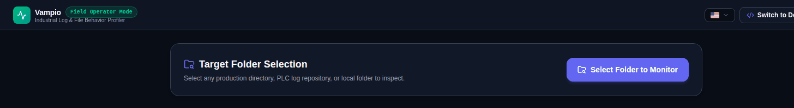

# Operator Mode

Operator Mode is a deliberately small interface for technicians and field engineers. Instead of designing schemas, you point Vampio at a folder of files and get a profile of how those files behave, which you can hand to a developer.

Choose it on first launch, or switch via **Switch to Operator Mode** in the `Others` menu. **Switch to Developer Studio** returns to the full app.

## Workflow

1. Click **Select Folder to Monitor** and choose a production directory, a PLC log repository, or any local folder.
2. Vampio reads the files locally and analyses them. Results are grouped in four tabs: **Recommendations**, **Metrics**, **Schema** and **Events**.
3. Click **Export Profile Bundle (.JSON)**.
4. A developer opens **Others → Import Machine Profile Bundle** in Developer Studio to load the bundle and auto-configure a matching workspace.

The same monitor is available inside Developer Studio as **Others → Target Folder Behavior Monitor**.

## What is detected

- Character **encoding** (for example UTF-8 and TIS-620) and likely languages
- Field **delimiter**
- **File locks**
- Aggregate metrics (file count, total size)
- A suggested column template, output format, filename pattern, write interval and rows per file

Nothing is uploaded; analysis happens on your device.

## Profile bundle format

The exported JSON contains:

| Key | Contents |
| :--- | :--- |
| `version`, `generatedAt`, `generator` | Bundle metadata |
| `source` | Platform (`web` or `tauri`), folder name and path, file count, total size |
| `metrics`, `forensics` | Folder statistics and encoding/delimiter/lock findings |
| `samplePreview` | A sample file name, raw snippet, inferred headers, and up to 5 sample rows |
| `vampioWorkspace` | Suggested `columns`, `tableName`, `outputStrategy`, `format`, `filenamePattern`, `intervalMs`, `rowsPerFile`, `targetFile` |

> The bundle includes a raw snippet and sample rows from your files. Review it before sharing if the data is sensitive.
