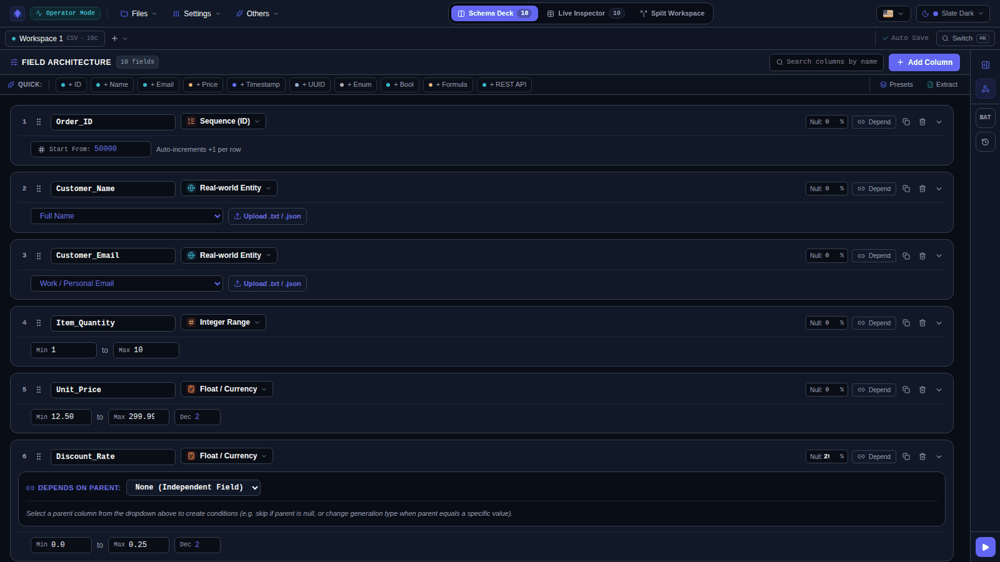
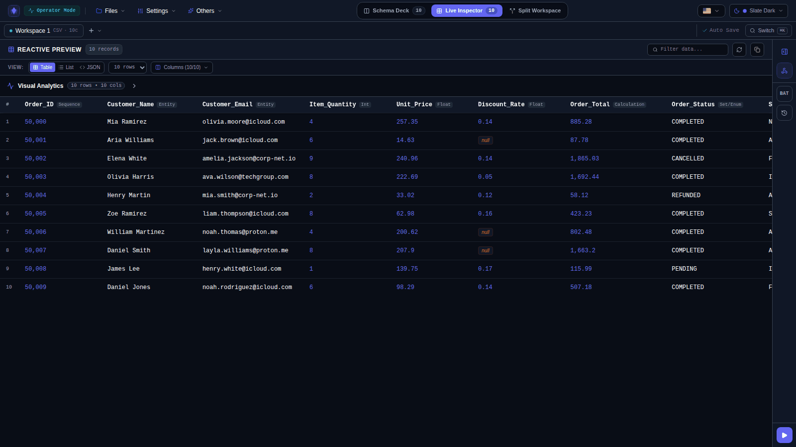
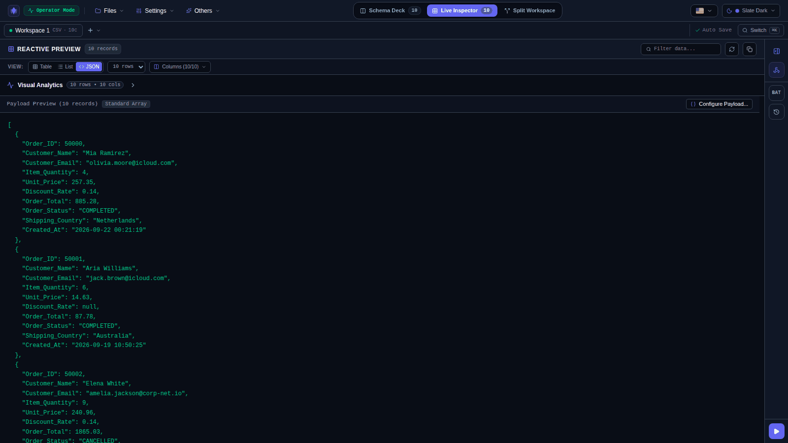
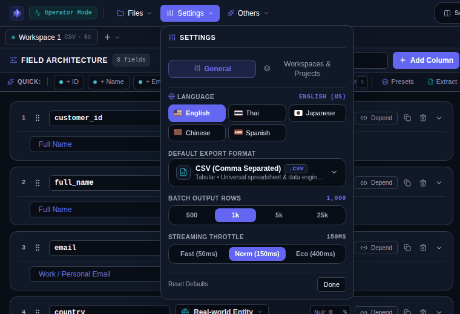
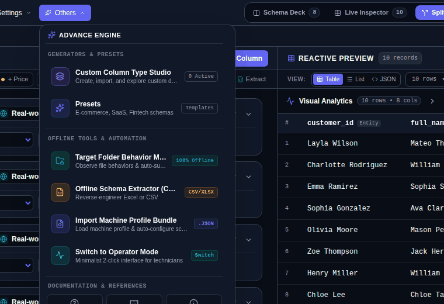
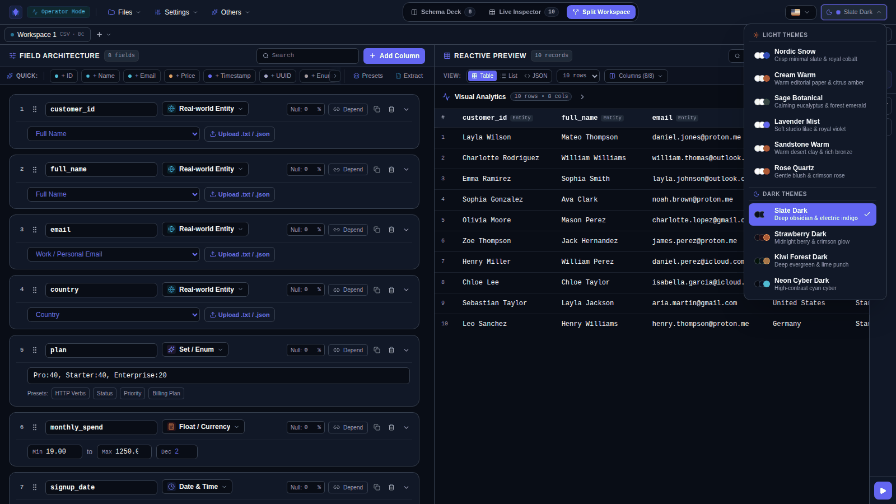

# Interface Tour

A walkthrough of the main screens in Developer Studio. For first-time setup see [Getting Started](./getting-started.md).

---

## Choosing a mode

On first launch Vampio asks how you want to work. The choice is saved locally and can be changed any time from the top bar.

- **Field Operator / Technician**: a minimal folder-monitoring interface. See [Operator Mode](./operator-mode.md).
- **Developer Studio**: the full schema designer and generator, described below.

---

## The workspace

| Area | Purpose |
| :--- | :--- |
| **Top bar** | `Files`, `Settings` and `Others` menus; the **Schema Deck / Live Inspector / Split Workspace** view switch; language and theme pickers. |
| **Workspace tabs** | One tab per workspace, an auto-save indicator, and the quick switcher (`Ctrl/Cmd+K`). |
| **Field Architecture** (left) | Column cards, a search box, **Add Column**, a quick-add strip (`+ ID`, `+ Name`, `+ Email`, `+ Price`, `+ Timestamp`, `+ UUID`, `+ Enum`, `+ Bool`, `+ Formula`, `+ REST API`), and **Presets** / **Extract** shortcuts. |
| **Reactive Preview** (right) | Live sample rows, a filter box, row count selector, column visibility, and the Visual Analytics bar. |
| **Right rail** | Generation Deck toggle (`Ctrl+J`), webhook add-on, Batch/Stream toggle, action log, and the **Generate** button. |

The three views:

- **Schema Deck** shows only the field editor.
- **Live Inspector** shows only the preview.
- **Split Workspace** shows both side by side (stacked on narrow screens).

---

## Live preview

Switch between **Table**, **List** and **JSON** views. Use the filter box or right-click a cell to filter (see [Search & Filters](./search-and-filters.md)).

| Table / Inspector | JSON |
| :---: | :---: |
|  |  |

Click the **Visual Analytics** bar to open the charts described in [Visual Analytics](./visual-analytics.md).

---

## Presets

**Presets** (header strip, `Others` menu, or the empty-state button) opens a library grouped by category: Logistics, Commerce, IoT & Telemetry, Security & Ops and HR & Directory. Use the search box or category chips to narrow the list, **Load Schema** to apply one, and **Import JSON** / **Export Current** to share your own.

---

## Extracting a schema from a file

Drop a spreadsheet on the field panel or click **Browse Excel / CSV**. The extractor has two steps: **Import & Focus Filter** and **Review Extracted Architecture**. In the review table you can change each field's name, type and rule, set the null %, see which fields were flagged **Masked** (likely sensitive) or **Public**, and choose **Replace** or **Append** before applying. Details: [Offline Schema Extractor](./offline-schema-extractor.md).

---

## Generating data

Open the Generation Deck from the right rail (`Ctrl+J`).

- **Execution mode**: *Batch File* or *Stream Live*.
- **Destination**: *Download* or *Local Folder*.
- **Output strategy**: *Smart Detect*, *Single File*, *Multi-File* or *In-Place Append*.
- **Target row count**: quick picks of 500, 1k, 5k, 25k and 100k, or a custom value.
- **Webhook add-on**: optional, off by default. See [Workspaces & Actions](./workspaces-and-actions.md).

---

## Menus

| Settings | Others |
| :---: | :---: |
|  |  |

- **Settings** has a *General* tab (language, default export format, batch output rows, streaming throttle) and a *Workspaces & Projects* tab.
- **Others** opens the Custom Column Type Studio, Presets, the Target Folder Behavior Monitor, the Offline Schema Extractor, machine profile bundle import, and the switch to Operator Mode.
- **Files** holds the output destination, project workspaces, session history, recent exports, blueprint import/export, and **Reset to Blank Schema**.

---

## Custom Column Type Studio

Tabs: **Examples**, **Import & Manage**, **Create Type**, **My Types**. See [Custom Types & Scripting](./custom-types-and-scripting.md).

---

## Themes and languages

Ten themes (six light, four dark) are available from the theme picker. The interface is translated into English, Spanish, Chinese, Japanese and Thai.

| Theme picker | Light theme |
| :---: | :---: |
|  |  |
